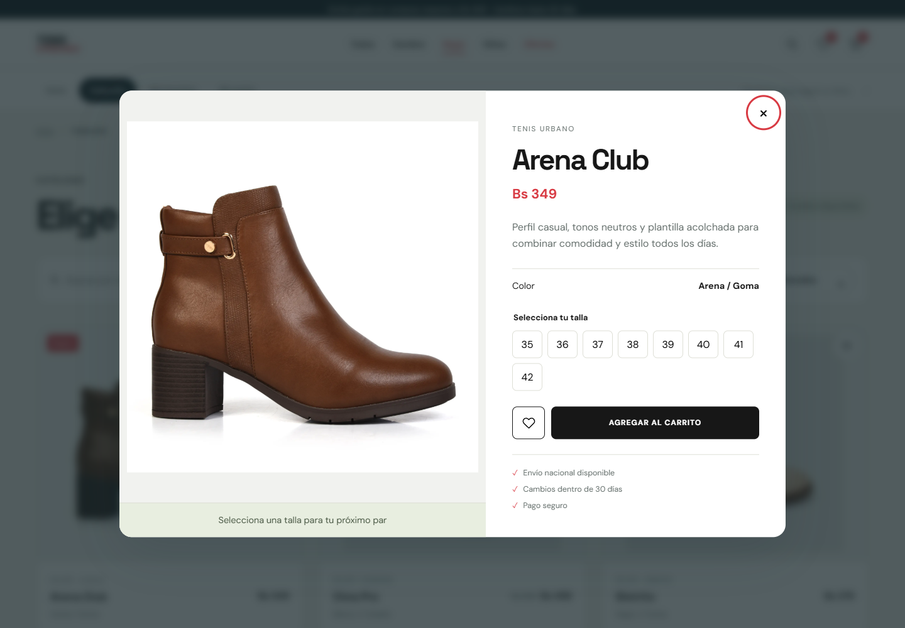

# H3 · Debate 4 · Refactor y evidencia

## Mejora aplicada

Se extrajo el comportamiento del diálogo de producto a `src/components/Modal.jsx`. La apariencia del detalle se mantiene y `Product` utiliza el nuevo componente mediante composición.

| Antes                                                                                                                      | Después                                                                                                                                        |
| -------------------------------------------------------------------------------------------------------------------------- | ---------------------------------------------------------------------------------------------------------------------------------------------- |
| `Product` controlaba el portal, apertura, cierre, bloqueo del fondo y retorno del foco, además de las tallas y el carrito. | `Modal` controla el diálogo; `Product` conserva el contenido, la selección de talla, favoritos, carrito y la decisión de navegación al cerrar. |
| El comportamiento del diálogo estaba ligado al producto.                                                                   | El contenedor recibe contenido con `children` y no importa datos de productos, contexto de tienda ni herramientas del router.                  |

## Decisión de refactorización

La composición permite utilizar el mismo contenedor para futuros diálogos, como una guía de tallas, sin copiar la lógica de accesibilidad y cierre. El mismo contenedor también se reutiliza en la confirmación de compra del carrito.

`Modal` recibe el contenido, los identificadores de título y descripción, la acción de cierre, el texto del botón, una clase visual y las opciones para devolver el foco. La página decide si corresponde volver a la ruta anterior o al catálogo. El componente se monta al abrirse y se desmonta al cerrarse.

## Accesibilidad

El contenedor utiliza un diálogo nativo que vuelve inerte el fondo. Centraliza el nombre y descripción accesibles, mantiene Tab y Shift+Tab dentro de la ventana y admite cierre con Escape. Al regresar a la vista de origen, devuelve el foco al producto y recupera la posición de desplazamiento.

La comprobación adicional detectó que el diálogo nativo por sí solo no garantizaba el ciclo inmediato de Shift+Tab entre el primer y el último control. Se añadió ese ciclo al contenedor reutilizable.

## Evidencia y verificación

[Detalle con talla seleccionada](04-detalle.png) · [Vista móvil](07-modal-movil.png)

La compilación de producción se completó y las seis pruebas automatizadas aprobaron. La prueba específica del modal comprueba:

- Apertura desde una categoría y conservación de sus tres productos filtrados.
- Bloqueo del desplazamiento del fondo.
- Ciclo de foco entre el primer y el último control con Tab y Shift+Tab.
- Validación de talla antes de agregar al carrito.
- Cierre mediante Escape, botón X y clic exterior.
- Retorno del foco al producto que abrió la ventana.
- Apertura mediante enlace directo, recarga y adaptación móvil.

Las demás pruebas comprueban navegación, búsqueda, ordenamiento, favoritos, selección de talla y persistencia del carrito.

## Aporte sugerido para responder a otra publicación

> Una prueba que puede aportar valor es enfocar el primer control del modal y pulsar Shift+Tab. El foco debería pasar al último control de la ventana; con Tab debería regresar al primero. Después, al cerrar con Escape, debería volver al elemento que abrió el modal. En este refactor comprobé ese recorrido y centralicé su comportamiento en el componente reutilizable.

Este texto es una propuesta de respuesta; no se publicó en ningún servicio externo.
